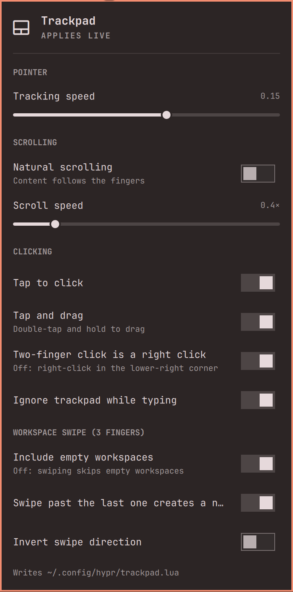
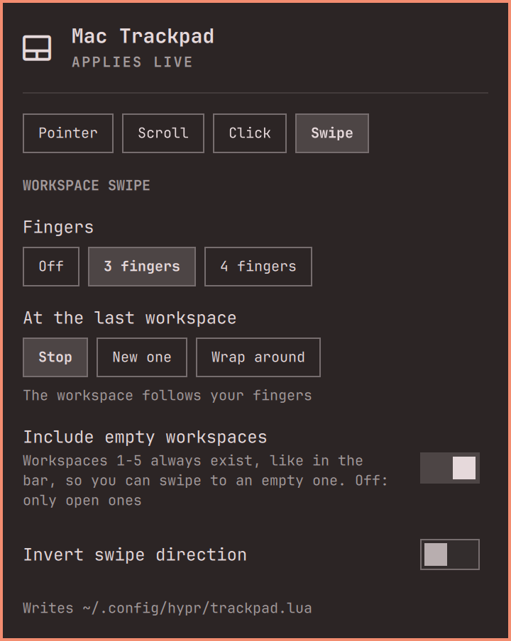
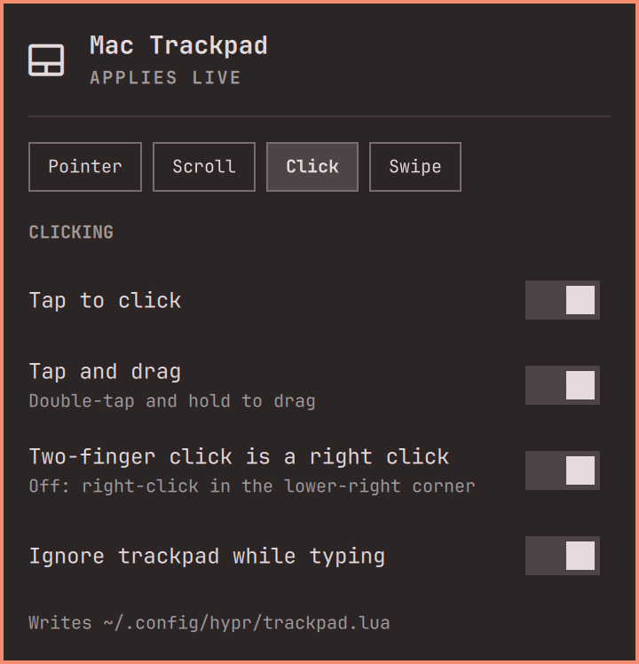
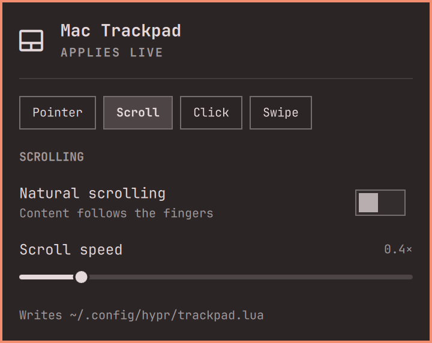
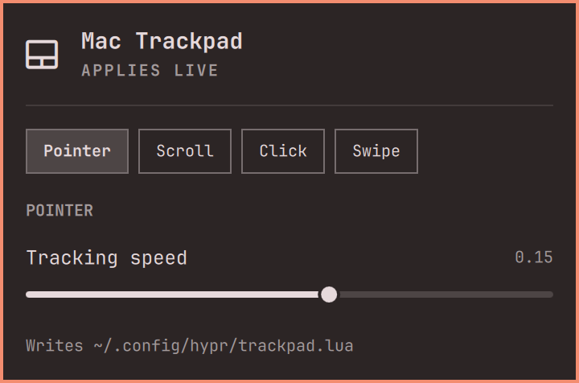

<div align="center">
  <picture>
    <source media="(prefers-color-scheme: dark)" srcset="docs/images/logo-dark.svg">
    
  </picture>
  <p><strong>The built-in trackpad, set up the way a Mac does it.</strong></p>
  <p>
    
    
    
    <a href="LICENSE"></a>
  </p>
</div>

# Mac Trackpad for Omarchy

Omarchy bar plugin for the built-in trackpad. Most of it is the right Hyprland and libinput
settings for a Mac feel, gathered in one menu: click the trackpad icon in the bar
(tabs: Pointer, Scroll, Click, Swipe) and change scrolling, pointer speed, tapping and clicking.
Every switch applies live; sliders apply when you let go. Nothing runs in the background.

The one part that is more than a setting is the **workspace swipe**. The plugin writes its own
three-finger gesture: the workspace follows your fingers, empty workspaces stay reachable like
Spaces on a Mac, the swipe works from workspace 1, and at the last workspace it stops, opens a
new one or wraps around (wrap switches when the swipe ends).

**Works with [MagicMouse](https://github.com/2strange/omarchy-magicmouse).** In its touchpad
mode the Magic Mouse acts as a trackpad that sends three fingers, so with Fingers set to 3 its
two-finger swipe is this same gesture: end of row, empty workspaces and direction come from
the Swipe tab here.



<p align="center"><sub>Screenshots from our MacBook Pro 11,3. Colors and fonts follow your Omarchy theme.</sub></p>

## A look around

<table>
  <tr>
    <td width="50%"><br><strong>A swipe like Spaces</strong><br>Three or four fingers; at the last workspace stop, open a new one or wrap around; empty workspaces stay reachable.</td>
    <td width="50%"><br><strong>Clicking the Mac way</strong><br>Tap to click, tap and drag, two fingers for a right click, and no stray touches while you type.</td>
  </tr>
  <tr>
    <td width="50%"><br><strong>Scrolling</strong><br>Natural scrolling and the scroll speed, applied the moment you let go of the slider.</td>
    <td width="50%"><br><strong>Pointer</strong><br>Tracking speed for the trackpad alone; a mouse keeps its own.</td>
  </tr>
</table>

## Settings

| Section | Setting | Hyprland option |
| --- | --- | --- |
| Pointer | Tracking speed (trackpad only, a mouse keeps its own) | `device { sensitivity }` |
| Scrolling | Natural scrolling | `input:touchpad:natural_scroll` |
| | Scroll speed | `input:touchpad:scroll_factor` |
| Clicking | Tap to click | `input:touchpad:tap-to-click` |
| | Tap and drag | `input:touchpad:tap-and-drag` |
| | Two-finger click is a right click | `input:touchpad:clickfinger_behavior` |
| | Ignore trackpad while typing | `input:touchpad:disable_while_typing` |
| Workspace swipe | Include empty workspaces | persistent workspaces 1-5 (`hl.workspace_rule`) |
| | At the last workspace: stop, new one, wrap around | `gestures:workspace_swipe_create_new` / own gestures |
| | Fingers: off, 3, 4 | `hl.gesture` in `trackpad.lua` |
| | Invert swipe direction | `gestures:workspace_swipe_invert` |

The plugin adds the workspace swipe itself (3 fingers by default; 4 fingers or
Off on the Swipe tab). If your `~/.config/hypr/input.lua` defines its own
horizontal `hl.gesture(...)` with the same number of fingers (whatever its
action), Hyprland refuses the second one: remove that line or set Fingers to Off.
The menu warns when both are active, and until then changes are rolled back.

**Upgrading from 1.0:** version 1.0 asked you to enable the swipe in `input.lua`.
If that line is still there, the plugin starts with Fingers set to Off, so your
swipe keeps working; remove the line and pick 3 or 4 fingers to get the new
end-of-row options.

**At the last workspace** you can stop, open a new workspace, or wrap around to
the first one. Stop and New one use Hyprland's own swipe: the workspace follows
your fingers and goes back if you change your mind. Hyprland's swipe cannot
wrap, so Wrap around uses two gestures that switch to the next or previous
workspace when the swipe ends.

**Include empty workspaces** works like Spaces on a Mac: workspaces 1-5 always
exist (the bar shows them anyway), so you can swipe to an empty one and start
something there. The plugin keeps them as persistent workspaces; without the
switch, the swipe only visits open workspaces. On several monitors the empty
1-5 are placed by Hyprland, usually on the first monitor. The plugin always
sets `gestures:workspace_swipe_use_r = false`, also over your own setting: with
it on, Hyprland's swipe does nothing at all on workspace 1.

## Install

```sh
omarchy plugin add https://github.com/2strange/omarchy-mactrackpad.git --enable
```

No password and no packages: it needs only `python3` and `hyprctl`, which Omarchy ships, and it
only writes files in `~/.config/hypr/`.

## How it works

- The menu calls `trackpad-config.py`, which writes `~/.config/hypr/trackpad.lua`
  from a JSON state line at the top of that file, reloads Hyprland and checks
  `hyprctl configerrors`. If Hyprland reports a new error, every file it touched
  is put back and the menu shows "rolled back". Errors that were already there
  before the change do not block it.
- On the first change it appends one marked block to `~/.config/hypr/input.lua`
  that loads `trackpad.lua`, unless `input.lua` already loads it. Nothing else in
  `input.lua` is modified. The block sits at the end of `input.lua`, so the menu
  wins over touchpad settings earlier in that file. If `input.lua` mentions
  `trackpad.lua` anywhere (even in a comment), the plugin assumes you load it
  yourself and adds nothing.
- The pointer speed is set per device. The plugin picks the first pointer whose
  name contains `bcm5974`, `applespi`, `touchpad` or `trackpad`; without one, the
  speed slider has no effect. MagicMouse's own `magic-mouse-…` virtual touchpads are skipped.
- Settings you never touched follow your current Hyprland values.

From a terminal:

```sh
cd ~/.config/omarchy/plugins/io.github.2strange.mactrackpad
python3 trackpad-config.py get
python3 trackpad-config.py set natural_scroll=true scroll_factor=0.6
```

**Coming from the plugin's old name** (Trackpad, `io.github.2strange.trackpad`): remove the old
plugin and add this one. Your settings in `trackpad.lua` stay, and `reset` also removes a
loader block the old version wrote.

```sh
omarchy plugin remove io.github.2strange.trackpad
omarchy plugin add https://github.com/2strange/omarchy-mactrackpad.git --enable
```

## Remove

```sh
python3 ~/.config/omarchy/plugins/io.github.2strange.mactrackpad/trackpad-config.py reset
omarchy plugin remove io.github.2strange.mactrackpad
```

`reset` deletes `trackpad.lua` and the marked block in `input.lua`, so Hyprland
falls back to your own or Omarchy's touchpad settings.

Tested on a MacBook Pro 11,3 (bcm5974) with Omarchy 4.0.6.

## License

MIT. See [LICENSE](LICENSE).
